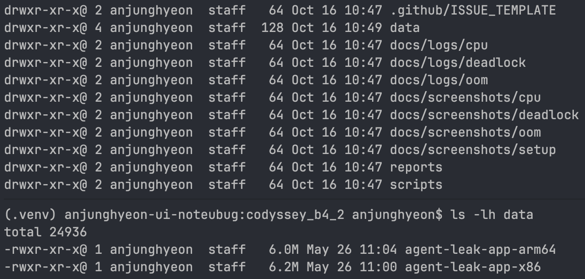
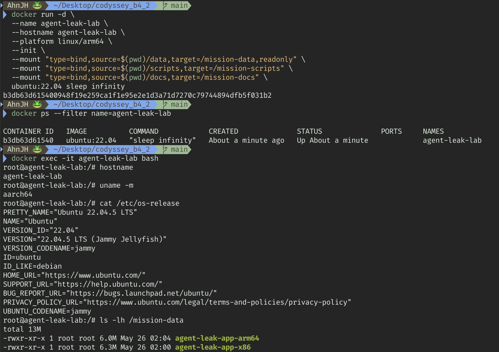
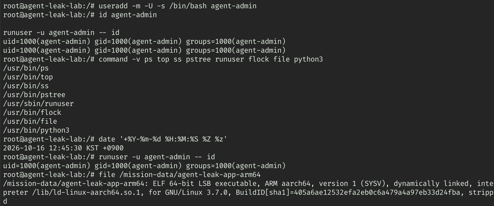
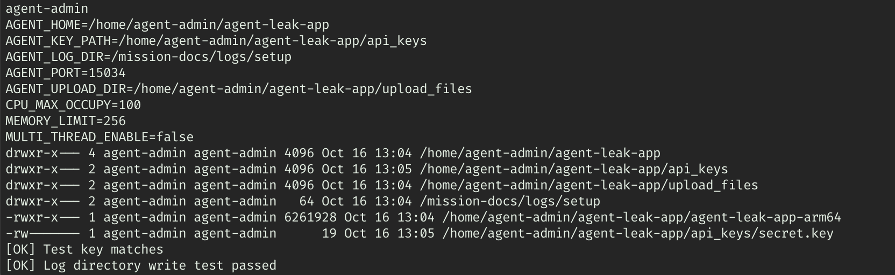
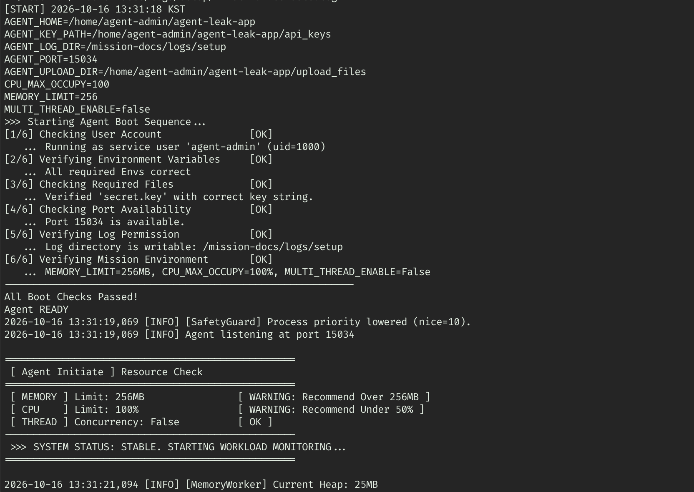
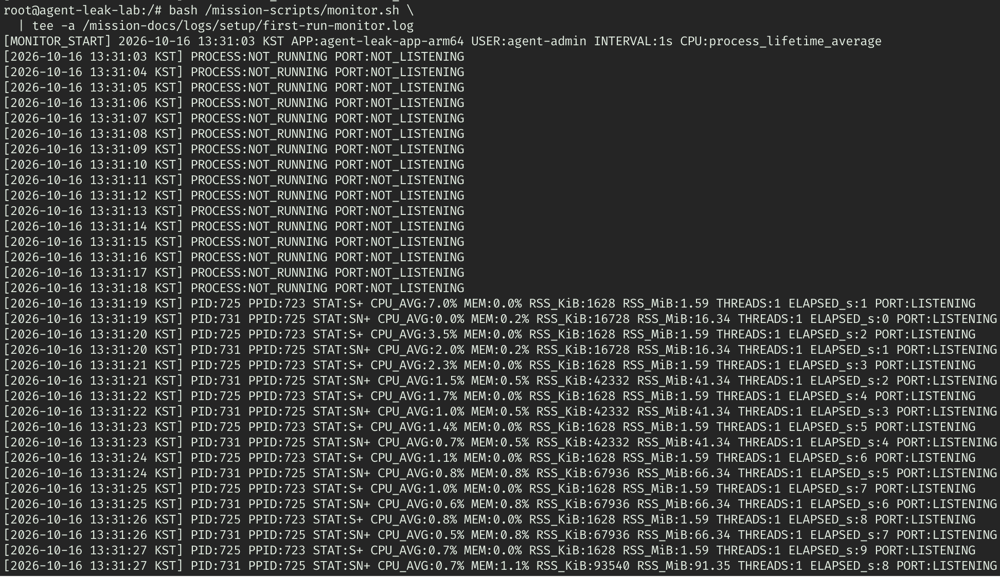
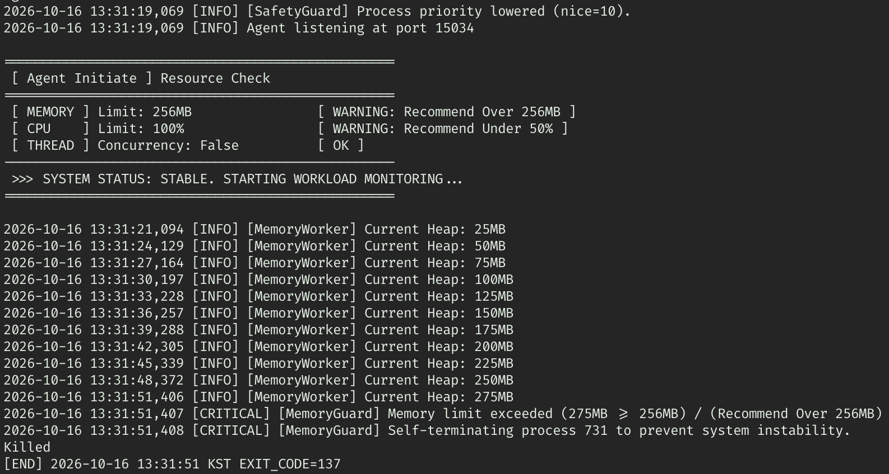
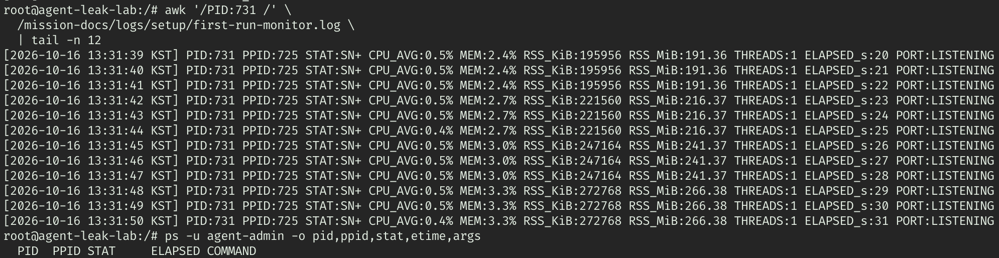

# Linux 프로세스 장애 분석 및 이슈 리포팅

제공된 `agent-leak-app-arm64`를 Linux 컨테이너에서 실행하고, 메모리 보호 종료·CPU 보호 종료·Deadlock의 설정 변경 전후를 실행 로그와 관제 자료로 비교했다. 실험은 2026-10-16과 2026-10-21(KST)에 수행했으며, 아래 내용은 저장소에 남은 증거를 기준으로 정리했다.

> **문서 상태: 실험 결과 및 증거 연결 완료.** CPU 보호 종료와 설정 변경 효과는 확인했지만, 실제 OS CPU 과점유와 요청 지연은 입증하지 못했다. 추가 측정이 필요한 항목은 아래에 남겼다.

## 1. 리포트와 결과 요약

| 리포트 | 변경 조건 | Before | After | 확인 범위 |
| --- | --- | --- | --- | --- |
| [OOM / MemoryGuard](reports/oom/oom.md) | `MEMORY_LIMIT=256 → 512` | Heap 275 MB에서 자체 종료, START~END 33초, 종료 코드 137 | Heap 525 MB에서 캐시 정리, RSS 감소와 작업 재개 확인. 작업 로그 20분 45초, 정리 19회 | 앱 메모리 보호 동작 비교. 커널 OOM Killer의 종료로 확정하지 않음 |
| [CPU / CpuWorker](reports/cpu/cpu.md) | `CPU_MAX_OCCUPY=100 → 30` | 내부 부하 52.59%에서 임계치 위반, START~END 34초, 종료 코드 143 | 내부 부하 30%에서 cooldown, 5%에서 재개. 약 20분 36초 작업 로그 | Before·After OS CPU 표본은 각각 부모 최대 7%, 자식 최대 5%. 실제 CPU 과점유·지연 증거 미확보 |
| [Deadlock](reports/deadlock/deadlock.md) | `MULTI_THREAD_ENABLE=true → false` | 두 스레드의 순환 대기 로그, PID 유지 및 10초 간격 측정에서 로그·CPU 시간·RSS 정체 | 작업 완료와 후속 자원 작업 확인, 시작 6분 35초 뒤 수동 종료 | 로그와 OS 관측에 근거한 진단. 구체적인 커널 대기 함수는 미확인 |

각 리포트에 재현 명령, 원본 로그 링크, 스크린샷과 설명, 원인 분석, Before & After 표를 연결했다. OOM과 CPU의 After 로그에는 캡처 이후 종료 기록도 있으므로, 캡처 시점의 생존을 전체 실행의 무종료나 장기 안정성으로 해석하지 않는다. 실행 경계와 종료 해석은 해당 리포트를 따른다.

## 2. 진행 현황

- [x] 실행 환경, 제공 바이너리와 일반 사용자 확인
- [x] 필수 환경변수, 디렉터리·키 검사와 로그 쓰기 권한 확인
- [x] 대상 앱의 PID별 CPU 평균·RSS·스레드 수·포트를 기록하는 [관제 스크립트](scripts/monitor.sh) 준비
- [x] OOM의 `MEMORY_LIMIT` 변경 전후 실행 및 증거 확보
- [x] CPU의 `CPU_MAX_OCCUPY` 변경 전후 실행 및 보호 동작 비교
- [x] Deadlock의 `MULTI_THREAD_ENABLE` 활성·비활성 비교 및 증거 확보
- [x] 이슈 리포트 3건 작성, 로그 및 스크린샷 연결
- [x] [공통 이슈 템플릿](.github/ISSUE_TEMPLATE/bug-report.md) 작성
- [x] README의 환경·결과·경로를 실제 증거에 맞게 갱신
- [ ] 실제 OS CPU 급상승과 요청 지연의 추가 측정
- [x] OOM 원본 관제에서 회복 직전·직후 동일 PID의 RSS 감소 확인
- [ ] 여러 메모리 회복 주기의 장기 추이 및 After 종료 사유 추가 검증

## 3. 확인한 실습 환경

| 항목 | 확인 결과 | 근거 |
| --- | --- | --- |
| 호스트 / 격리 환경 | macOS 터미널에서 Docker 사용 | [컨테이너 생성 화면](docs/screenshots/setup/01-environment.png) |
| 컨테이너 | `agent-leak-lab`, 이미지 `ubuntu:22.04` | [환경 화면](docs/screenshots/setup/01-environment.png) |
| Linux OS / 아키텍처 | Ubuntu 22.04.5 LTS / `aarch64`, 플랫폼 `linux/arm64` | [OS 확인](docs/screenshots/setup/01-environment.png), [바이너리 확인](docs/screenshots/setup/02-tools-and-user.png) |
| 앱 실행 계정 | `agent-admin`, UID/GID 1000 | [계정·도구 확인](docs/screenshots/setup/02-tools-and-user.png) |
| 시간대 | KST, UTC+09:00 | [시각 확인](docs/screenshots/setup/02-tools-and-user.png) |
| 실행 파일 | `/home/agent-admin/agent-leak-app/agent-leak-app-arm64` | [설정·권한 확인](docs/screenshots/setup/03-app-configuration.png) |
| 앱 포트 | 컨테이너 내부 TCP `15034` | [부팅 로그](docs/logs/setup/first-run-console.log), [관제 로그](docs/logs/setup/first-run-monitor.log) |
| 관측 도구 | `monitor.sh`, `ps`, `top`, `ss` 등 | [도구 확인](docs/screenshots/setup/02-tools-and-user.png), 각 리포트 |
| 실험 일자 | OOM·CPU: 2026-10-16 / Deadlock: 2026-10-21(KST) | 각 리포트의 START 및 END 기록 |

환경 점검·관제는 관리자 셸에서도 수행했으나, 앱은 `runuser`를 통해 일반 사용자로 실행했다. 바이너리 디컴파일 및 리버스 엔지니어링은 수행하지 않고 실행 로그와 Linux 도구 출력으로 분석했다.

### 실행 환경변수

[설정 화면](docs/screenshots/setup/03-app-configuration.png)과 [초기 실행 로그](docs/logs/setup/first-run-console.log)에서 확인한 값이다.

| 항목 | 실제 설정 또는 확인 결과 |
| --- | --- |
| `AGENT_HOME` | `/home/agent-admin/agent-leak-app` |
| `AGENT_PORT` | `15034` |
| `AGENT_UPLOAD_DIR` | `$AGENT_HOME/upload_files`, 디렉터리 및 실행 계정 권한 확인 |
| `AGENT_KEY_PATH` | `$AGENT_HOME/api_keys`, `secret.key` 검사 통과 |
| `AGENT_LOG_DIR` | `/mission-docs/logs/setup`, 쓰기 검사 통과 |
| 초기 `MEMORY_LIMIT` | `256` MB |
| 초기 `CPU_MAX_OCCUPY` | `100` |
| 초기 `MULTI_THREAD_ENABLE` | `false` |

앱 자체 로그의 경로와 실험별 콘솔 저장 경로는 다르다. 앱 로그는 `AGENT_LOG_DIR`을 사용하고, 콘솔·관제 출력은 `tee`로 `docs/logs/{실험}/`에 별도 저장했다. [agent_app.log](docs/logs/setup/agent_app.log)에는 여러 실행이 함께 들어 있으므로 실행 시각과 PID를 구분해야 한다.

### 컨테이너와 저장소 경로 대응

| 저장소 경로 | 컨테이너 경로 | 용도 |
| --- | --- | --- |
| `data/` | `/mission-data` (읽기 전용) | 제공 바이너리, Git 추적 제외 |
| [scripts/](scripts/) | `/mission-scripts` | 관제 스크립트 |
| [docs/](docs/) | `/mission-docs` | 제출용 로그·스크린샷 |

컨테이너 생성 화면에는 호스트 포트 게시 옵션이 없다. 여기서 확인한 리스닝 상태는 컨테이너 내부 기준이다.

## 4. 저장소 구성

| 경로 | 내용 |
| --- | --- |
| [README.md](README.md) | 실험 환경, 결과 요약, 증거 안내 |
| [.gitignore](.gitignore) | 바이너리·키·개인 설정·임시 파일 제외 |
| [scripts/monitor.sh](scripts/monitor.sh) | 대상 앱의 PID별 관제 |
| [reports/oom/oom.md](reports/oom/oom.md) | 메모리 보호 종료와 설정 변경 비교 |
| [reports/cpu/cpu.md](reports/cpu/cpu.md) | CPU 보호 동작과 OS 실측 비교 |
| [reports/deadlock/deadlock.md](reports/deadlock/deadlock.md) | 순환 대기와 설정 변경 후 작업 진행 비교 |
| [.github/ISSUE_TEMPLATE/bug-report.md](.github/ISSUE_TEMPLATE/bug-report.md) | 새 GitHub 이슈 작성용 공통 양식 |
| [docs/logs/setup/](docs/logs/setup/) / [docs/screenshots/setup/](docs/screenshots/setup/) | 환경 점검과 초기 실행 자료 |
| [docs/logs/oom/](docs/logs/oom/) / [docs/screenshots/oom/](docs/screenshots/oom/) | OOM 탐색 실행 및 조건을 맞춘 비교 자료 |
| [docs/logs/cpu/](docs/logs/cpu/) / [docs/screenshots/cpu/](docs/screenshots/cpu/) | CPU 비교와 보조 확인 자료 |
| [docs/logs/deadlock/](docs/logs/deadlock/) / [docs/screenshots/deadlock/](docs/screenshots/deadlock/) | Deadlock 비교 및 스레드 확인 자료 |

README, 리포트, 템플릿, 관제 스크립트와 제출용 증거를 관리한다. 제공 바이너리, 키, 개인용 `.env`, 가상환경 및 루트 `logs/`는 제외한다. **제출용 로그는 `docs/logs/`에 보관하며 `*.log` 전체를 제외하지 않는다.**

## 5. 실행 및 비교 방법

아래 명령은 증거를 수집한 환경의 재현 절차다. 기존 `agent-leak-lab`과 일반 사용자, 필수 환경변수·디렉터리·테스트 키가 준비되어 있어야 한다. 실제 실행별 명령과 수치는 각 리포트에 기록했다.

Mac 터미널에서 컨테이너 상태를 확인하고 접속한다.

```bash
docker ps -a --filter name=agent-leak-lab
docker exec -it agent-leak-lab bash
```

컨테이너에서 계정, 시각, 실행 파일 및 포트 사용 여부를 확인한다. 이전 실험의 앱이 실행 중이면 먼저 해당 실행의 증거와 종료 경계를 기록해야 한다.

```bash
id agent-admin
date '+%Y-%m-%d %H:%M:%S %Z'
file /mission-data/agent-leak-app-arm64
ls -l /home/agent-admin/agent-leak-app
ps -u agent-admin -o pid,ppid,stat,etime,args
ss -ltnp 'sport = :15034'
```

각 실행에서는 별도 터미널에서 관제를 먼저 시작하고, 앱 실행 로그를 다른 파일로 기록했다. 로그인 셸이 프로파일을 읽은 **뒤에** 실험값을 `export`하여 기본 설정이 실험값을 덮어쓰는 것을 피했다.

| 비교 | Before | After | 고정한 조건 |
| --- | --- | --- | --- |
| OOM | `MEMORY_LIMIT=256` | `MEMORY_LIMIT=512` | `CPU_MAX_OCCUPY=30`, `MULTI_THREAD_ENABLE=false` |
| CPU | `CPU_MAX_OCCUPY=100` | `CPU_MAX_OCCUPY=30` | `MEMORY_LIMIT=512`, `MULTI_THREAD_ENABLE=false` |
| Deadlock | `MULTI_THREAD_ENABLE=true` | `MULTI_THREAD_ENABLE=false` | `MEMORY_LIMIT=512`, `CPU_MAX_OCCUPY=30` |

처음 메모리를 512로 높인 탐색 실행에서는 CPU 보호 종료가 먼저 발생했다. OOM의 본 비교는 CPU 설정을 30으로 맞춘 `controlled-before` / `controlled-after` 로그를 사용한다. 초기 실행 및 탐색 실행을 본 비교와 혼합하지 않았다.

`tee -a`는 기존 파일에 내용을 덧붙인다. 재실행할 때는 파일명을 구분하거나 START·END·수동 종료 기록과 PID로 실행 경계를 남긴다. 종료 코드 기록 예제는 Bash의 `PIPESTATUS[0]`으로 앱 실행 명령 쪽 상태를 가져오며, `tee`의 상태와 구분한다.

## 6. 환경 점검 및 초기 실행 스크린샷

장애별 스크린샷과 원본 로그는 [OOM 리포트](reports/oom/oom.md), [CPU 리포트](reports/cpu/cpu.md), [Deadlock 리포트](reports/deadlock/deadlock.md)의 증거 절에 연결했다. 파일명만으로 내용을 판단하지 않고 실제 화면에 맞춰 설명했다.

### 6.1 저장소와 컨테이너 준비

초기 디렉터리와 제공된 ARM64·x86 바이너리 배치 화면이다. 현재 리포트는 유형별 하위 폴더에 정리되어 있다.



Ubuntu 22.04 컨테이너를 `linux/arm64`로 생성하고, 컨테이너 이름·OS·아키텍처를 확인했다.



### 6.2 사용자·도구·앱 설정

일반 사용자 UID/GID 1000, 도구 경로, KST 시각 및 ARM aarch64 실행 파일을 확인했다.



필수 경로와 초기 실험값, 디렉터리 권한, 테스트 키 일치 및 로그 쓰기 검사를 확인했다.



### 6.3 초기 부팅 및 관제

초기값은 `MEMORY_LIMIT=256`, `CPU_MAX_OCCUPY=100`, `MULTI_THREAD_ENABLE=false`다. 부팅 검사 통과와 15034 포트 리스닝 로그를 확인했다. 원본은 [초기 실행 로그](docs/logs/setup/first-run-console.log)에 있다.



관제는 13:31:03에 시작했다. 앱 시작 전에는 `NOT_RUNNING`, 시작 후에는 부모 PID 725·자식 PID 731과 `LISTENING`을 기록했다. 원본은 [초기 관제 로그](docs/logs/setup/first-run-monitor.log)에 있다.



### 6.4 초기 메모리 보호 종료

Heap 25 MB부터 275 MB까지 증가한 뒤 MemoryGuard가 자체 종료를 기록했다. START 13:31:18부터 END 13:31:51까지 33초이며 종료 코드는 137이다. 이는 CPU 설정을 30으로 맞춘 OOM 본 비교보다 앞선 실행이다.



자식 PID 731의 마지막 RSS 표본은 266.38 MiB였고, 종료 후 `ps` 목록에 앱 행이 없다. 관제 원본에서도 13:31:51에 `NOT_RUNNING / NOT_LISTENING`을 기록했다.



## 7. 측정값 해석 원칙

- **앱 Heap과 OS RSS:** 앱이 출력한 MB와 OS가 측정한 RSS(MiB)는 범위와 단위가 다르다. 부모·자식 프로세스를 구분하고, 같은 프로세스의 스레드 행에 반복 표시된 RSS를 합산하지 않는다.
- **CPU 지표:** `monitor.sh`의 `CPU_AVG`와 `ps`의 `%CPU`는 프로세스 생존 기간 평균이다. CPU 비교에는 갱신 구간을 측정하는 `top`도 사용했다. 앱의 `Current Load`는 정의가 확인되지 않은 내부 지표다.
- **보호 종료와 수동 종료:** MemoryGuard·CpuWorker 로그를 종료 코드와 함께 해석한다. 코드 137·143만으로 종료 주체를 단정하지 않으며, Deadlock 증거 수집 후의 수동 종료를 자동 보호 종료로 기록하지 않는다.
- **생존과 진행:** PID 존재나 포트 리스닝만으로 작업 진행을 판단하지 않는다. 마지막 로그, 로그 증가, 스레드 CPU 시간과 메모리 변화를 함께 확인한다.
- **관측 기간:** 스크린샷의 경과 시간, 원본 로그의 마지막 작업 시각, 종료 시각을 구분한다. 캡처 이후 자료는 해당 실행의 시각·PID와 연결해 해석한다.

## 8. 공통 이슈 템플릿

[.github/ISSUE_TEMPLATE/bug-report.md](.github/ISSUE_TEMPLATE/bug-report.md)에 다음 공통 구조를 작성했다. 템플릿의 빈칸은 새 이슈를 작성할 때 채우는 입력 항목이다.

1. Description: 발생 시각, 환경, 재현 조건과 관측 증상
2. Evidence & Logs: 실제 명령, 원본 로그, PID·수치 및 스크린샷
3. Root Cause Analysis: 확인한 사실, 원인 추론과 미확인 범위
4. Workaround & Verification: 변경 조건, Before & After와 검증 한계

## 9. 남은 확인 항목

| 항목 | 현재 증거 | 추가로 필요한 자료 |
| --- | --- | --- |
| 실제 CPU 과점유·지연 | 내부 부하 임계치 위반 및 보호 종료, 낮은 OS CPU 표본 | 해당 앱 PID의 CPU 급상승 구간과 요청 응답 시간 |
| OOM 회복 및 종료 | PID 37449의 RSS 516.63 → 16.55 MiB, 정리 19회와 작업 재개. 코드 1의 END 기록 2개 | 여러 회복 주기의 장기 추이와 중복 END의 실행 경계·종료 사유 |
| CPU After 종료 | 약 20분 36초 작업 진행 후 코드 120, 다른 날짜의 수동 종료 메모 | 종료 코드와 후행 메모의 관계 및 종료 원인 |
| Deadlock의 내부 구현 | 자원 보유·순환 대기 로그와 스레드 정체, `WCHAN=-` | 구체적인 대기 함수·락 구현 확인은 이번 분석 범위 밖 |

빈 결과를 예시값으로 채우지 않고, 확보된 결과와 추가 검증 범위를 구분했다. 현재 실험값 변경은 바이너리의 소스 결함 수정이나 장기 안정성을 보장하는 조치가 아니다.

## 10. 제출 전 확인

- [x] 세 리포트에 현상·증거·원인 분석·조치 및 검증을 기록
- [x] Before & After의 설정값·시각·단위와 관측 범위를 명시
- [x] 실제 파일 경로로 원본 로그 및 스크린샷 연결
- [x] 초기 탐색 실행, 본 비교, 수동 종료와 후행 기록을 구분
- [x] 제공 바이너리·키 파일이 기존 Git 추적 목록에 없음을 확인
- [ ] 실제 CPU 급상승 및 지연 증거 보완
- [ ] 최종 Repository 링크 또는 PDF 제출

## 11. 참고

- 미션 명세: 제공된 시스템 장애 분석 및 리포팅 과제
- [Linux Kernel 문서 — /proc 파일시스템과 프로세스 메모리 정보](https://cdn.kernel.org/doc/html/latest/filesystems/proc.html)
- 각 리포트 하단의 종료 상태 및 프로세스 관측 도구 참고 문서
